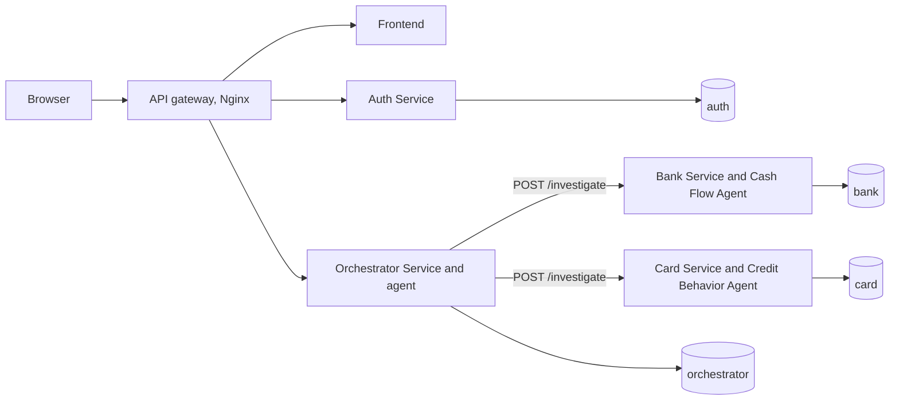

# multiagent-credit-review

Credit Risk Review Agent: a course proof of concept modelled on the credit risk review workflow at Ramp. A risk engine flags a customer whose numbers moved, three agents work out why, and an analyst approves before anything changes.

All customers and data are simulated. This project is not affiliated with Ramp.

## Status

Skeleton only. Every service starts, connects to its own database and answers `/health`. Nothing else is built yet.

## Architecture



Four FastAPI services, each with its own Postgres database and login role. The gateway exposes only the frontend, Auth and the Orchestrator. The Bank and Card services are called by the Orchestrator only.

## Run it

Needs Docker.

```bash
docker compose up --build
```

| URL | What |
|---|---|
| http://localhost:8080 | frontend placeholder |
| http://localhost:8080/api/auth/health | Auth through the gateway |
| http://localhost:8080/api/orchestrator/health | Orchestrator through the gateway |
| http://localhost:8001/health to :8004 | auth, bank, card, orchestrator directly (local only) |

To start again with empty databases: `docker compose down -v`.

### Configuration

Compose falls back to local default passwords, so no `.env` file is needed on your machine. To override them, or on a server, copy `.env.example` to `.env` and set real values. `.env` is ignored by git.

| Variable | Used by | Notes |
|---|---|---|
| `POSTGRES_PASSWORD` | postgres | superuser password |
| `AUTH_DB_PASSWORD`, `BANK_DB_PASSWORD`, `CARD_DB_PASSWORD`, `ORCHESTRATOR_DB_PASSWORD` | postgres and the matching service | letters, digits and hyphens only, because they go into a connection URL |

Database passwords are applied when the Postgres volume is first created. After changing one, run `docker compose down -v` and start again.

Names reserved for later, so every service uses the same ones: `JWT_SECRET`, `AS_OF_DATE`, `LLM_API_KEY`, `LANGFUSE_PUBLIC_KEY`, `LANGFUSE_SECRET_KEY`, `LANGFUSE_HOST`.

## Layout

| Path | What | Owner |
|---|---|---|
| `services/bank` | Bank Service and Cash Flow Agent | Allen |
| `services/card` | Card Service and Credit Behavior Agent | James |
| `services/orchestrator` | Orchestrator Service and agent | Vincent |
| `services/auth` | login, JWT, roles | to be assigned |
| `gateway` | Nginx API gateway | to be assigned |
| `frontend` | review app (React) | to be assigned |
| `packages/contracts` | models shared by the services | all three |
| `data` | test customers, one source for both data generators | all three |
| `eval` | golden dataset runs and results | to be assigned |
| `infra/postgres` | creates the four databases | to be assigned |

## Working agreements

- One branch per Jira ticket, named after it: `KAN-21-bank-investigate`. Open a pull request into `main` and put the ticket key in the title.
- Another member reviews before merge. GitHub does not enforce this on our plan, so it is on us.
- Services never import each other's code and never read each other's database. They talk over HTTP. Shared types live in `packages/contracts`.
- A change to `packages/contracts` or `data` needs all three owners.
- No secrets and no real customer data in git.
- `main` always starts with `docker compose up --build`.

Board: https://lqc0304.atlassian.net/jira/software/projects/KAN/boards/2
