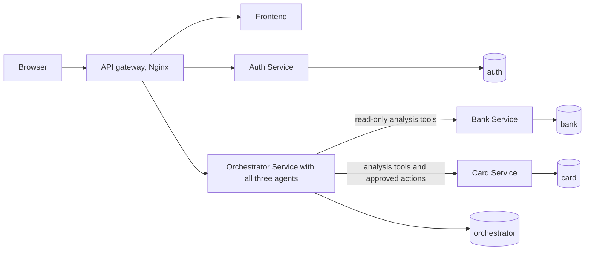

# multiagent-credit-review

Credit Risk Review Agent: a course proof of concept modelled on the credit risk review workflow at Ramp. A risk engine flags a customer whose numbers moved, three agents work out why, and an analyst approves before anything changes.

All customers and data are simulated. This project is not affiliated with Ramp.

## Status

- **Orchestrator**: takes a review signal at `POST /signals`, investigates the case on a LangGraph graph, writes a report that code checks, pauses for the analyst and, where needed, the manager, and sends an approved action to Card. It asks the real Cash Flow and Card agents (`SPECIALISTS=stand_in` switches to stand-ins that read the data files). If Bank or Card is down, the case waits and retries, then fails with the reason. It keeps closed reviews as history and traces every model and tool call to LangFuse. See `services/orchestrator/README.md`.
- **Bank**: seeds every customer in `data/shared_customers.yaml` and `eval/extra_customers.yaml` as a complete bank feed (every movement of the week, 13 weeks of history, last year's same weeks) and serves the Cash Flow agent's read-only tools. See `services/bank/README.md`.
- **Card**: seeds the same customers with about 14 months of card history. `GET /snapshots` gives each customer's limit, balance and last three repayments. Its read-only tools serve the Card agent, and `POST /customers/{id}/actions` carries out an approved `reduce_limit` or `pause_card` once per approval.
- **Evaluation**: a golden set of 27 test customers with expected answers, graded by code (`eval/`). Verified on the real model on 2026-11-17 on four cases; the full set has not been run yet.
- **Auth, frontend**: skeletons. Auth answers `/health`; tokens come from `python -m app.dev_token` in the Orchestrator container. The frontend is a placeholder page.

## Architecture



Four FastAPI services, each with its own Postgres database and login role. The gateway exposes only the frontend, Auth and the Orchestrator. The Bank and Card services are called by the Orchestrator only.

All three agents run in the Orchestrator Service: the main agent and the two specialists (Cash Flow, Card), which it calls as tools in-process. Bank and Card run no model. They own the data and serve read-only analysis tools over HTTP. The stand-ins in `services/orchestrator/app/agents/mock.py` answer from the data files instead; the tests use them.

## Run it

Needs Docker.

```bash
docker compose up --build
```

| URL | What |
|---|---|
| http://localhost:8080 | frontend placeholder |
| http://localhost:8080/api/auth/health | Auth through the gateway |
| http://localhost:8080/api/orchestrator/health | Orchestrator through the gateway |
| http://localhost:8001/health to :8004 | auth, bank, card, orchestrator directly (local only) |

To start again with empty databases: `docker compose down -v`. A volume seeded by an older version fails at start, so run it after pulling data or schema changes too.

### Run one case end to end

This spends money on the model (about $0.50 a case). Set `LLM_MODEL`, `LLM_API_KEY` and `LLM_STRUCTURED_OUTPUT=json_schema` in `.env` (see Configuration), and the LangFuse keys if you want traces. Then, from the repository root, with the Orchestrator's test environment (see Run the tests):

```bash
docker compose -p e2e -f docker-compose.yml -f eval/docker-compose.eval.yml up -d --build
services/orchestrator/.venv/bin/python scripts/e2e.py --customer c_013
docker compose -p e2e down -v
```

It sends one customer's signal, prints the agent's questions and the checked report, approves as the analyst (and the manager when needed), and checks that Card did what the report says. Any customer in the two data files works. Options and expected results are in `scripts/README.md`.

### Run the tests

The tests need Python 3.12 and nothing else: no Docker, no database server, no model, no network. Each service has its own environment:

```bash
for s in orchestrator bank card; do
  (cd services/$s && python3.12 -m venv .venv && .venv/bin/pip install -q -r requirements-dev.txt ../../packages/contracts)
done
(cd services/orchestrator && .venv/bin/python -m pytest -q)
(cd services/bank && .venv/bin/python -m pytest -q)
(cd services/card && .venv/bin/python -m pytest -q)
```

Run them in a shell without the stack's variables (`LLM_*`, `LANGFUSE_*`, `SHARED_CUSTOMERS_*`): the tests set their own. Card's Postgres-only tests run when `CARD_PG_URL` points at a Postgres database, and are skipped otherwise.

### Run the evaluation

`eval/run.py` sends every golden-set customer through a fresh stack and grades the answers: recommendation, cause, hand-over, citations, precision and recall of cuts, cost and time. It costs about $0.45 a case and run. To try a few cases once:

```bash
INVESTIGATION_FLOW=agent docker compose -p goldenset -f docker-compose.yml -f eval/docker-compose.eval.yml up -d --build
services/orchestrator/.venv/bin/python eval/run.py --arm agent --only c_013 c_009 --reps 1 --container "docker compose -p goldenset exec -T orchestrator"
docker compose -p goldenset down -v
```

Each arm needs a fresh stack. Everything else, including how to compare arms, is in `eval/README.md`.

### Configuration

Compose falls back to local defaults for the passwords and the signing secret, so no `.env` file is needed on your machine. To override them, or on a server, copy `.env.example` to `.env` and set real values. `.env` is ignored by git.

| Variable | Used by | Notes |
|---|---|---|
| `POSTGRES_PASSWORD` | postgres | superuser password |
| `AUTH_DB_PASSWORD`, `BANK_DB_PASSWORD`, `CARD_DB_PASSWORD`, `ORCHESTRATOR_DB_PASSWORD` | postgres and the matching service | letters, digits and hyphens only, because they go into a connection URL |
| `JWT_SECRET` | the Orchestrator, Bank and Card | signs and checks tokens. One shared secret in the POC, 32 characters or more. The compose fallback is public, so anyone can sign tokens on a stack that runs without `.env`: set a real one on any shared or deployed stack |
| `LLM_MODEL`, `LLM_API_KEY`, `LLM_STRUCTURED_OUTPUT` | Orchestrator | the model cases run on, as `provider:model`, for example `anthropic:claude-sonnet-5-5` or `openai:<model>` (both packages are installed; only Anthropic has been run). Empty by default: signals are stored and their cases wait as `queued`. `LLM_STRUCTURED_OUTPUT=json_schema` is recommended with Anthropic |
| `LANGFUSE_PUBLIC_KEY`, `LANGFUSE_SECRET_KEY`, `LANGFUSE_BASE_URL` | Orchestrator | LangFuse tracing. Empty by default: cases run without tracing. Keys go in your own `.env` only. Set the base URL your LangFuse project shows, or keys from another region are refused |
| `SPECIALISTS` | Orchestrator | empty: the real Cash Flow and Card agents, which call Bank and Card. `stand_in`: the stand-ins, which answer from the data files with no service and no model |

The Orchestrator also reads these. `docker-compose.yml` does not pass them yet, so on the main stack they keep the defaults shown; the evaluation overlay sets them (`eval/README.md`).

| Variable | Default | What |
|---|---|---|
| `INVESTIGATION_FLOW` | empty, which is `agent` | who chooses the questions: `agent` (the model), `fixed` (a written plan) or `fixed_rules` (the plan, then what code's gap list names). Used to compare arms in the evaluation |
| `EMBEDDINGS_MODEL` | `hash:384` (set in the image) | the embedder for the search over past reviews. `fastembed:BAAI/bge-small-en-v1.5` needs an image built with `WITH_EMBEDDINGS=1` |
| `HISTORY_SEED_FILE` | `/eval/history.yaml` | past reviews seeded at every start |
| `SHARED_CUSTOMERS_FILE` | `/data/shared_customers.yaml`, the image's copy of `data/shared_customers.yaml` | the customer files the stand-in specialists answer from, separated by `:`. A signal for a customer they do not hold gets a 422 |

Database passwords are applied when the Postgres volume is first created. After changing one, run `docker compose down -v` and start again.

Reserved for later, so every service uses the same name: `AS_OF_DATE`.

## Layout

| Path | What | Owner |
|---|---|---|
| `services/bank` | Bank Service: bank data and read-only analysis tools | Allen |
| `services/card` | Card Service: card data, read-only analysis tools, approved actions | James |
| `services/orchestrator` | Orchestrator Service: the graph, cases and approvals | Vincent |
| `services/orchestrator/app/agents/cash_flow` | Cash Flow Agent | Allen |
| `services/orchestrator/app/agents/card_service` | Credit Behavior Agent (Card Service agent) | James |
| `services/auth` | login, JWT, roles | to be assigned |
| `gateway` | Nginx API gateway | to be assigned |
| `frontend` | review app (React) | to be assigned |
| `packages/contracts` | models shared by the services | all three |
| `data` | test customers, one source for both data generators | all three |
| `eval` | golden dataset runs and results | to be assigned |
| `infra/postgres` | creates the four databases | to be assigned |

## Working agreements

- One branch per Jira ticket, named after it: `KAN-20-cash-flow-tools`. Open a pull request into `main` and put the ticket key in the title.
- Another member reviews before merge. GitHub does not enforce this on our plan, so it is on us.
- Services never import each other's code and never read each other's database. They talk over HTTP. Shared types live in `packages/contracts`.
- Inside the Orchestrator, each agent folder exposes one entry function. The graph calls that function and nothing else in the folder. An agent reaches data only through the analysis tools, never through a database connection.
- A change to `packages/contracts` or `data` needs all three owners.
- No secrets and no real customer data in git.
- `main` always starts with `docker compose up --build`.

Board: https://lqc0304.atlassian.net/jira/software/projects/KAN/boards/2
