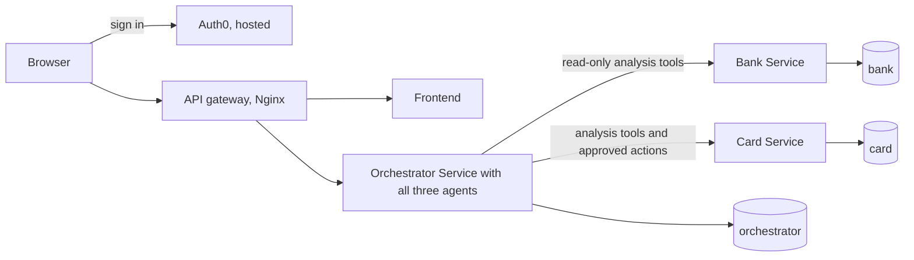
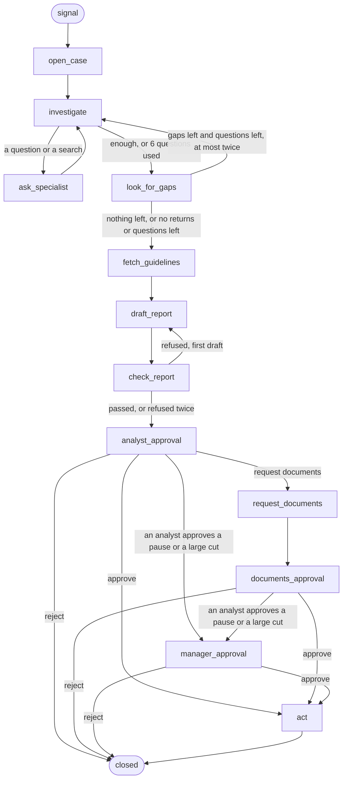
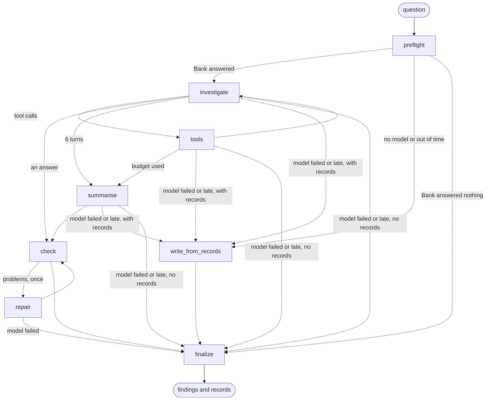
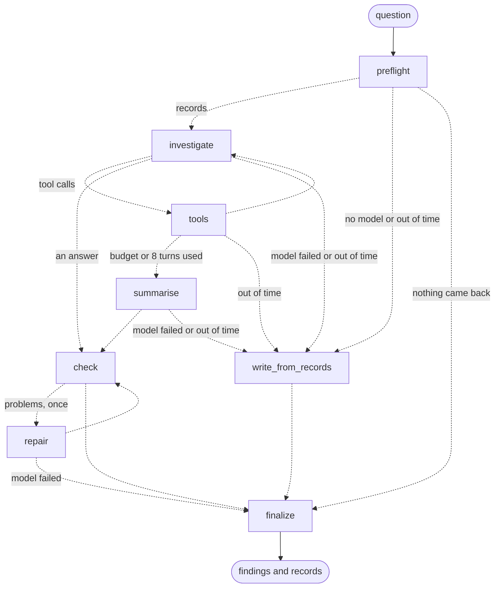
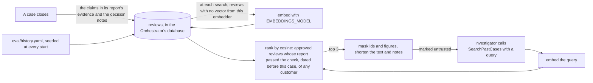

# multiagent-credit-review

Credit Risk Review Agent: a proof of concept modelled on the credit risk review workflow at Ramp. A risk engine flags a customer whose numbers moved, three agents work out why, and an analyst approves before anything changes.

All customers and data are simulated. This project is not affiliated with Ramp.

## What it does

- **Orchestrator**: takes a review signal at `POST /signals`, investigates the case on a LangGraph graph, writes a report that code checks, pauses for the analyst and, where needed, the manager, and sends an approved action to Card. It asks the real Cash Flow and Card agents (`SPECIALISTS=stand_in` switches to stand-ins that read the data files). On the agent flow, after the specialists answer, the investigator is told to search earlier approved reviews of any customer, as background it cannot cite. If Bank or Card gives a specialist nothing, the case waits and retries 1, 5 and then 15 minutes apart, then fails with the reason. If Card does not carry out an approved action, the approver sends it again. It keeps closed reviews as history, writes a monthly PDF/A report of the month's cases, and, with LangFuse keys set, traces every model and tool call to LangFuse. See `services/orchestrator/README.md`.
- **Bank**: seeds every customer in `data/shared_customers.yaml` (and, on a stack started with `eval/docker-compose.eval.yml` or `demo/docker-compose.demo.yml`, `eval/extra_customers.yaml`) as a complete bank feed (every movement of the week, 13 weeks of history, last year's same weeks) and serves the Cash Flow agent's read-only tools. See `services/bank/README.md`.
- **Card**: seeds the same customers with about 15 months of card history. `GET /snapshots` gives each customer's limit, balance and last three repayments. Its read-only tools serve the Card agent, and `POST /customers/{id}/actions` carries out an approved `reduce_limit` or `pause_card` once per approval.
- **Review app**: React. The queue has three tabs: Waiting on me (analysts and managers only), All open and Closed. A case page shows the engine's proposal, the checked report with every cited record, how the case was investigated, and the decisions. A rejection needs a reason. When the report hands the case to a person, the analyst or manager picks the outcome, and a picked cut or pause goes through the same steps as a recommended one. Approving a request for documents leaves the limit as it is; code drafts the message and a due date for the person to send, and the case waits until someone records what the documents showed. Once Card acts, the page shows Card's receipt and the next steps, simulated: nothing is sent. The queue and the case page update live through server-sent events; the queue also polls every 5 seconds, and the case page polls while the agent works. See `frontend/README.md`.
- **Sign-in**: people sign in through Auth0 when `AUTH0_DOMAIN`, `AUTH0_AUDIENCE` and `AUTH0_CLIENT_ID` are set. Otherwise, with `DEV_LOGIN=1`, they use a dev login with no password; keep that to your own machine (`services/auth/README.md`).

## Results

A golden set of 27 test customers with accepted answers, graded by code (`eval/`). It holds normal and business cases, cases with missing, conflicting or misleading data, bank memos written to steer the reviewer, and cases that must go to a person (`eval/golden-set.md`).

| Run | Recommendation right | Cause right | Model cost |
|---|---|---|---|
| 2026-11-18, Claude Sonnet 5.5 | 24 of 27 | 23 of 27 | $11.51 |
| 2026-11-22, Claude Sonnet 5.5 | 24 of 27 | 23 of 27 | $11.71 |

- No cut or pause where the case does not accept one, in either run.
- The same four misses both times: c_007, c_107 and c_307 gave up after the check refused both report drafts, and c_314 was handed over with a cause the case does not accept.
- The service refused all five requests it must refuse (no review reasons, unknown customer, no token, another customer's case, a signal sent with an analyst's token) on 2026-11-18.
- Each case ran once and only the agent flow ran, so run-to-run stability is not known.

Reports: `eval/golden-set-report-2026-11-18.md` and `eval/golden-set-report-2026-11-22.md`. The 2026-11-22 cases can be loaded to show the review app (`demo/`).

## Architecture



Built with Python 3.12, FastAPI, SQLAlchemy, PostgreSQL 16, LangGraph and LangChain, LangFuse, React with React Router and TypeScript, Nginx and Docker Compose. Kubernetes and RabbitMQ are optional (Deploy).

Three FastAPI services do the work, each with its own Postgres database and login role. The gateway exposes the frontend, the Orchestrator and the Auth placeholder's `/health`; Bank and Card are called by the Orchestrator only. Services never import each other's code or read each other's database: they talk over HTTP, and shared types live in `packages/contracts`.

People sign in through Auth0, which issues their tokens. Each service checks the tokens it receives itself: every one checks a service's token against `JWT_SECRET`, and the Orchestrator and Card check a person's against Auth0's keys. Bank takes service tokens only (`services/bank/README.md`). Without Auth0 settings, people's tokens are signed with `JWT_SECRET` too, by the dev login (`DEV_LOGIN=1`) or `python -m app.dev_token`. `services/auth` is a placeholder that answers `/health` behind `/api/auth/` and keeps the Auth0 setup; it issues no tokens.

All three agents run in the Orchestrator Service: the main agent and the two specialists (Cash Flow, Card), which it calls as tools in-process. Each agent folder exposes one entry function. The specialists reach Bank and Card data only through the analysis tools. Besides their answers, the main agent reads the signal, the credit guidelines and the Orchestrator's own closed reviews. Bank and Card run no model. They own the data and serve read-only analysis tools over HTTP. The stand-ins in `services/orchestrator/app/agents/mock.py` answer from the data files instead; the tests use them.

Each FastAPI service writes one JSON log line per event to stdout. A request that came through the gateway carries its `X-Request-ID` as `request_id`, which the Orchestrator passes on to Bank and Card, and a case run's lines carry `case_id` (`packages/contracts/README.md`). The gateway's access log ends each line with the same id and leaves out query strings. The review app writes a JSON line to the browser console for each failed call, with the id, so a failure on screen can be found in the services' logs. With LangFuse keys set, each case is one LangFuse session: the investigation and each decision are traces in it, with every graph step and model call.

### The main agent

The case graph (`services/orchestrator/app/graph/build.py`). It saves every step in the Orchestrator's database, so a case can pause and resume: at each approval step until a person decides, and before a question whose service gave nothing until it is asked again. Three model roles work in it: the investigator, the gap reviewer and the report writer. The diagram shows the agent flow. On the two fixed flows, which the evaluation can run to compare with it, code asks the questions and no model runs before the report writer.



| Node | Who | What |
|---|---|---|
| `open_case` | code | reads the signal, the customer's earlier reviews and the guidelines, and writes the investigator's opening brief |
| `investigate` | model | the investigator asks a specialist a question, searches past cases, or stops |
| `ask_specialist` | code | checks the question, then calls the specialist about the case's one customer, or runs the search. The specialist makes its own token for that customer. Free text in the records (memos, notes) comes back marked untrusted, and so does a search's whole result. If Bank or Card gives the specialist nothing, the case waits before this question |
| `look_for_gaps` | code, then model | code lists what the guidelines still need; when it finds nothing, the gap reviewer looks. Gaps send the investigator back |
| `fetch_guidelines` | code | loads the guidelines for the report |
| `draft_report` | model | the report writer drafts the report from the facts, the answers and the guidelines |
| `check_report` | code | checks the draft (Guardrails). A low-confidence report, or two refused drafts, goes to a person as `needs_human` |
| `analyst_approval` | person | an analyst or a manager approves or rejects; approving a hand-over may pick its outcome. The review app asks for a reason to reject |
| `request_documents` | code | drafts the message and the due date; nothing is sent |
| `documents_approval` | person | records what the customer's documents showed |
| `manager_approval` | person | a manager confirms a pause or a large cut |
| `act` | code | sends an approved cut or pause to Card with the approver's token; nothing for `keep_limit` or a hand-over approved without a pick. If Card does not carry it out, the case waits here: the approver sends it again, or a manager rejects and the case closes as failed |

### The two specialists

Each specialist is a LangGraph graph of its own. The investigator's question runs it once, with a 60-second deadline for the whole run, and it keeps nothing between questions. No model or service call starts after the deadline; Cash Flow also cuts off a model call still running at it. Both graphs have the same nodes. They differ in their tools (Bank's for Cash Flow, Card's for Card), in where the turn limit sits, and in whether a repeated tool call counts against the budget.

Cash Flow (`services/orchestrator/app/agents/cash_flow/`):



Card (`services/orchestrator/app/agents/card_service/`):



| Node | Who | What |
|---|---|---|
| `preflight` | code | calls the tools the question's topic rests on, outside the budget |
| `investigate` | model | reads the question and the records, then calls tools or answers in JSON |
| `tools` | code | runs the model's tool calls: 5 at most, a repeated call answered from the cache without asking the service again (it counts in Cash Flow, not in Card), memos marked as data |
| `summarise` | model | once the budget or the turns are used: answers from what was fetched, with no tools |
| `check` | code | checks every finding: its record ids, its figures, and that it proposes no action |
| `repair` | model | once: told what failed, answers again |
| `write_from_records` | code | with no model, or when the model failed or ran out of time: findings written from the records alone |
| `finalize` | code | adds findings code writes on the topic, and returns the findings with every record preflight fetched and every record they cite, as the service returned them |

### Past-case search

A small retrieval step over the Orchestrator's own closed reviews. It has no vector database: each review's vector is stored with it, and ranking is exact cosine in Python (`services/orchestrator/app/retrieval.py`).



It is offered only on the agent flow and only when an embedder loads. A case may search twice without using any of the 6 questions; a search past those two, or one that is refused or fails, uses one. A result names no case, customer or record and gives no score: it says whether it is the same customer, and gives the date, the review reasons, the cause, the recommendation, the guidelines, the outcome, what the analyst decided on a hand-over, and the claims and notes, masked and shortened. The whole result reaches the model marked untrusted, and a report cannot cite it.

## Roles and approvals

Every rule below is checked by the services, not only by the review app.

- `analyst`: reads and decides the cases of the customers their token lists. An analyst's approval stands alone, except for a card pause or a cut of more than half the limit, which then needs a manager.
- `manager`: the same, and gives the manager's approval. A manager may also ask for the monthly report, which covers every customer's cases. At the manager step it must be a manager who did not approve the step before. A manager who approves a pause or a large cut at the analyst step signs alone.
- `admin`: may send signals and ask for the monthly report, and decides no step. The dev login never issues it; without Auth0, `docker compose exec orchestrator python -m app.dev_token --role admin --sub <name>` makes one.
- `service`: sends signals. A specialist's token names the case's one customer and lasts 3 minutes.

The agents change nothing. After a person approves a cut or a pause, code sends it to Card with the approver's own token, and Card checks the role and the step again before it acts.

## Guardrails

- The specialists read Bank and Card only through read-only tools scoped to the case's customer. The past-case search reads earlier approved reviews of any customer; their text and notes have ids and figures masked. Memos and decision notes are marked as untrusted before a model reads them; the exceptions are under Known limits.
- The investigator asks at most 6 questions and searches past cases at most twice; the gap review can send it back at most twice.
- Code checks every report draft: every cited record must be one the case holds, every review reason must be addressed, the cause must rest on a cited record, the cited guideline must allow the recommendation and have what it needs, and every figure must appear in the records cited. A refused draft is redrafted once; if that is refused too, the case goes to a person.
- A low-confidence report goes to a person instead of recommending an action.
- No action reaches Card before a person approves, and Card applies each approval once.
- A signal with no review reasons, or for a customer the data does not hold, is refused.

## Data the agents read, and what leaves the company

Every customer and record is simulated. The table is what the code does; the last list is what it does not guard against.

| Data | The agents read it | Sent to the model provider (Anthropic) | Sent to LangFuse (cloud) |
|---|---|---|---|
| The case customer's Bank and Card records: amounts, dates, categories, payee kind, repayments, card balances | yes, through read-only tools | yes | yes |
| Account name and last 4 digits; merchant names; card nicknames | yes | yes | yes |
| Text the customer typed (transaction memos) | yes | yes, marked as untrusted text; withheld from the gap reviewer and the report writer | yes, unmarked |
| Credit guidelines | yes | yes | yes |
| Earlier reviews of the same customer | typed fields only: dates, outcome, cause, action | yes | yes |
| Approved earlier reviews of any customer (past-case search) | as background, never cited | yes, marked as untrusted, with ids and figures in their text and notes masked | yes |
| Payee names, customer company names, full account and card numbers | no: Bank and Card do not return them | no | no |
| Who decided this case: Auth0 sub and email | no | no | yes, in the case state |
| The decision note | not in this case; once it closes, the past-case search of later cases reads it | in later cases only, masked and marked as untrusted | yes, in the case state |
| Tokens, model and LangFuse keys, `JWT_SECRET`, passwords | no | no | no |

How the code holds to it:

- The specialists reach Bank and Card data only through their read-only tools. Each call carries a service token for the one customer of the case, valid for 3 minutes; Bank and Card refuse any other customer (403). The customer comes from the case, never from a model.
- Bank returns a payee's kind, not its name (`services/bank/app/ledger.py`). Neither service returns the customer's company name or a card number.
- Memos are marked as untrusted before a model reads them, and withheld from the gap reviewer's and the report writer's briefs (`services/orchestrator/app/graph/facts.py`). Decision notes reach a model only in past-case results, which go to the investigator alone under an untrusted header (`services/orchestrator/app/graph/build.py`).
- Past-case results have ids and figures replaced before the investigator reads them (`services/orchestrator/app/retrieval.py`), and a report cannot cite them.
- No key or token goes into a prompt or a trace.

Known limits before real data (acceptable on simulated data):

- LangFuse is a third-party cloud service and receives everything above: raw tool results with memos unmarked, and the case state with approvers' emails and notes. With real data: self-host it, or mask before export.
- The investigator's question goes to the specialists as written, checked only for figures, so words from a past-case result or a gap pass can reach them unmarked.
- Merchant names, card nicknames and account names go to the provider as they are. With real customers they would be replaced by categories or withheld.
- The signal contract does not limit an account mask to 4 digits (`packages/contracts`).

## Quick start

You need git, Docker and Python 3.12. A model API key is needed only to run cases (steps 3 and 4).

```bash
git clone https://github.com/lqc412/multiagent-credit-review.git
cd multiagent-credit-review
```

1. Run the tests: [Run the tests](#run-the-tests). No Docker, no key. This also creates the Python environment steps 3 and 4 use.
2. Start the stack and check the health URLs: [Run it](#run-it).
3. Run one case on the real model, from signal to Card's action: [Run one case end to end](#run-one-case-end-to-end).
4. Grade a few cases against the golden set: [Run the evaluation](#run-the-evaluation).

The stacks of steps 2, 3 and 4 use the same ports, so run one at a time (`docker compose down -v` stops step 2's, `docker compose -p e2e down -v` and `docker compose -p goldenset down -v` the others).

## Run it

Needs Docker.

```bash
docker compose up --build
```

| URL | What |
|---|---|
| http://localhost:8080 | the review app (React) |
| http://localhost:8080/api/auth/health | the Auth placeholder through the gateway |
| http://localhost:8080/api/orchestrator/health | Orchestrator through the gateway |
| http://localhost:8001/health to :8004 | auth, bank, card, orchestrator directly (local only) |

To sign in on the review app with Auth0, put the three `AUTH0_*` values in `.env` and leave `DEV_LOGIN` empty (`services/auth/README.md`). For the dev login instead, copy `.env.example` to `.env` before starting: it sets `DEV_LOGIN=1`, which turns on the dev login (a name and a role, no password). Keep it to your machine: leave `DEV_LOGIN` empty on any host others can reach. Without a model (Configuration) the queue stays empty until a signal arrives, and a signal's case waits as `queued`.

Every service built here is rebuilt from the checkout on each `up` (`pull_policy: build`), with or without `--build`, so expect those containers to restart each time.

To start again with empty databases: `docker compose down -v`. This also deletes the monthly reports kept in the `reports` volume. There are no migrations, so run it after pulling data or schema changes too: on a volume made by an older version, a service can fail at start or on every request until it is reset.

To show the review app with the 27 golden-set cases the real model investigated on 2026-11-22, each waiting for the analyst: `demo/load.sh`. It deletes the local stack's volumes first and needs a model in `.env`. A person sees only the customers their token lists: the dev login lists c_001 to c_013, and `demo/README.md` says how to add the rest for an Auth0 user.

To have workers fed by RabbitMQ investigate new cases: set a model and `RABBITMQ_URL` in `.env` as `.env.example` shows, and start with `docker compose --profile mq up -d`. Decisions and retries still run in the Orchestrator.

### Run one case end to end

This spends money on the model (about $0.55 for c_010, and $0.19 to $0.67 for the other golden-set customers). If you have no `.env` yet, create it from the example. Then set the model (see Configuration), and the LangFuse keys if you want traces:

```bash
[ -f .env ] || cp .env.example .env
# then in .env: LLM_MODEL=anthropic:claude-sonnet-5-5, LLM_API_KEY=<your key>, LLM_STRUCTURED_OUTPUT=json_schema
```

Then, from the repository root, with the Orchestrator's test environment (see Run the tests):

```bash
docker compose -p e2e -f docker-compose.yml -f eval/docker-compose.eval.yml up -d --build
services/orchestrator/.venv/bin/python scripts/e2e.py
docker compose -p e2e down -v
```

It sends one customer's signal (c_010 by default), prints the agent's questions and the checked report, approves as the analyst (and the manager when needed), and checks that Card did what the report says. For c_010 the report should recommend `pause_card` under G-08b, and Card's card goes from `active` to `paused`. `--customer c_009` runs another customer; any customer in the two data files works. Options and expected results are in `scripts/README.md`.

### Run the tests

The tests need Python 3.12 and nothing else: no Docker, no database server, no model, no network. Each service has its own environment:

```bash
for s in orchestrator bank card; do
  (cd services/$s && python3.12 -m venv .venv && .venv/bin/pip install -q -r requirements-dev.txt ../../packages/contracts)
done
(cd services/orchestrator && .venv/bin/python -m pytest -q)
(cd services/bank && .venv/bin/python -m pytest -q)
(cd services/card && .venv/bin/python -m pytest -q)
```

Run them in a shell without the stack's variables (`LLM_*`, `LANGFUSE_*`, `SHARED_CUSTOMERS_*`): the tests set their own. Tests that only mean something on Postgres are skipped unless `TEST_DATABASE_URL` (Orchestrator: the whole suite then runs there and drops its tables) or `CARD_PG_URL` (Card) names a throwaway Postgres database.

Every pull request, and every push to main, runs these three suites and the frontend build on GitHub Actions (`.github/workflows/tests.yml`).

### Run the evaluation

`eval/run.py` sends every golden-set customer through a fresh stack and grades the answers: recommendation, cause, hand-over, citations, precision and recall of cuts, cost and time. It costs about $0.43 a case and run; `--reps` defaults to 3, so the whole set at the default is about 80 runs, roughly $35. To try a few cases once:

```bash
INVESTIGATION_FLOW=agent docker compose -p goldenset -f docker-compose.yml -f eval/docker-compose.eval.yml up -d --build postgres bank card orchestrator
services/orchestrator/.venv/bin/python eval/run.py --arm agent --only c_013 c_009 --reps 1 --container "docker compose -p goldenset exec -T orchestrator"
docker compose -p goldenset down -v
```

Each arm needs a fresh stack. Everything else, including how to compare arms, is in `eval/README.md`.

### Configuration

Compose falls back to local defaults for the passwords and the signing secret, so the stack starts with no `.env` file. Signing in to the review app needs one (Run it). To override the defaults, or on a server, copy `.env.example` to `.env` and set real values. `.env` is ignored by git.

| Variable | Used by | Notes |
|---|---|---|
| `POSTGRES_PASSWORD` | postgres | superuser password |
| `AUTH_DB_PASSWORD`, `BANK_DB_PASSWORD`, `CARD_DB_PASSWORD`, `ORCHESTRATOR_DB_PASSWORD` | postgres and the matching service | letters, digits and hyphens only, because they go into a connection URL |
| `JWT_SECRET` | the Orchestrator, Bank and Card | signs and checks tokens. One secret shared by the services, 32 characters or more. The compose fallback, which `.env.example` also sets, is public, so anyone can sign tokens on a stack that keeps it: set a real one on any shared or deployed stack |
| `AUTH0_DOMAIN`, `AUTH0_AUDIENCE`, `AUTH0_CLIENT_ID` | the Orchestrator and Card (domain, audience); the frontend build (all three) | the Auth0 tenant's domain, the API identifier and the review app's client id. All set: people sign in through Auth0 and `JWT_SECRET` signs services' tokens only; leave `DEV_LOGIN` empty then. Empty by default (`services/auth/README.md`) |
| `DEV_LOGIN` | Orchestrator | `1` turns on `POST /dev_login`, the review app's sign-in without Auth0: a name and a role, no password. Empty in compose, `1` in `.env.example`. Leave it empty with Auth0 and on any host others can reach |
| `LLM_MODEL`, `LLM_API_KEY`, `LLM_STRUCTURED_OUTPUT` | Orchestrator | the model cases run on, as `provider:model`, for example `anthropic:claude-sonnet-5-5` or `openai:<model>` (both packages are installed; only Anthropic has been run). Empty by default: signals are stored and their cases wait as `queued`. `LLM_STRUCTURED_OUTPUT=json_schema` is recommended with Anthropic |
| `LANGFUSE_PUBLIC_KEY`, `LANGFUSE_SECRET_KEY`, `LANGFUSE_BASE_URL` | Orchestrator | LangFuse tracing. Empty by default: cases run without tracing. Keys go in your own `.env` only. Set the base URL your LangFuse project shows, or keys from another region are refused |
| `SPECIALISTS` | Orchestrator | empty: the real Cash Flow and Card agents, which call Bank and Card. `stand_in`: the stand-ins, which answer from the data files with no service and no model |
| `EMBEDDINGS_MODEL`, `WITH_EMBEDDINGS` | Orchestrator | the embedder for the search over past reviews. Default `fastembed:BAAI/bge-small-en-v1.5`, built into the image (`WITH_EMBEDDINGS=1`, which fetches the model from huggingface.co). Offline, set `WITH_EMBEDDINGS=0` and `EMBEDDINGS_MODEL=hash:384` together |
| `RABBITMQ_URL` | Orchestrator | empty: cases run inside the Orchestrator. Set, with `--profile mq`: each new case's investigation goes to RabbitMQ and the `worker` container runs it. Keep its user and password the same as `RABBITMQ_USER` and `RABBITMQ_PASSWORD`, which the broker and the worker use |
| `REPORTS_BUCKET`, `AWS_REGION` | Orchestrator | where the monthly report is kept. Empty: the stack's `reports` volume. Set: that S3 bucket, or `gs://<bucket>` for Cloud Storage. Credentials come from the cloud host's instance role or service account, never keys in `.env`. `docker-compose.yml` passes no AWS profile or gcloud login into the container, so a bucket does not work on a laptop stack. `AWS_REGION` is the S3 bucket's region, `us-east-1` by default |

The Orchestrator also reads these. `docker-compose.yml` does not pass them, so on the main stack they keep the defaults shown. The evaluation overlay sets them (`eval/README.md`), and the demo overlay sets the last two (`demo/docker-compose.demo.yml`).

| Variable | Default | What |
|---|---|---|
| `INVESTIGATION_FLOW` | empty, which is `agent` | who chooses the questions: `agent` (the model), `fixed` (a written plan) or `fixed_rules` (the plan, then what code's gap list names). Used to compare arms in the evaluation |
| `HISTORY_SEED_FILE` | `/eval/history.yaml` | past reviews seeded at every start |
| `SHARED_CUSTOMERS_FILE` | `/data/shared_customers.yaml`, the image's copy of `data/shared_customers.yaml` | the customer files the stand-in specialists answer from, separated by `:`. A signal for a customer they do not hold gets a 422 |

Database passwords are applied when the Postgres volume is first created. After changing one, run `docker compose down -v` and start again.

`AS_OF_DATE`: the day Bank and Card read their data on. Unset, they use the data file's `signal_date`; set it only to that date, since the data is laid out around it. The Orchestrator does not read it, and `docker-compose.yml` does not pass it.

## Deploy

`docker compose up` runs the whole system on one machine. `k8s/` runs the same services on Kubernetes, with case workers fed by RabbitMQ that KEDA scales from 1 to 5 by queue length: on kind on a laptop (`k8s/up.sh`, the app on http://127.0.0.1:8088), on k3s on one AWS EC2 instance (`k8s/aws/`), or on k3s on one Google Cloud VM (`k8s/gcp/`). Neither cloud setup is open to the internet: the app is reached through an SSM or IAP tunnel and a port-forward. `scripts/e2e.py` passed on both clouds with the real model. Commands, costs and every check are in `k8s/README.md`.

## Documentation

- `services/orchestrator/README.md`: endpoints, the graph, approvals, outage handling, history, tracing, the monthly report
- `services/bank/README.md` and `services/card/README.md`: the data and the read-only analysis tools; Card's approved actions
- `services/auth/README.md`: Auth0 setup and tokens
- `frontend/README.md`: the review app
- `gateway/README.md`: the gateway's routes
- `packages/contracts/README.md`: models shared by the services, and the log format
- `data/README.md`: the simulated test customers
- `eval/README.md`: the golden-set evaluation
- `scripts/README.md`: the smoke test and the end-to-end run
- `demo/README.md`: loading the 2026-11-22 cases
- `k8s/README.md`: the Kubernetes deployment

## License

MIT, see `LICENSE`.
