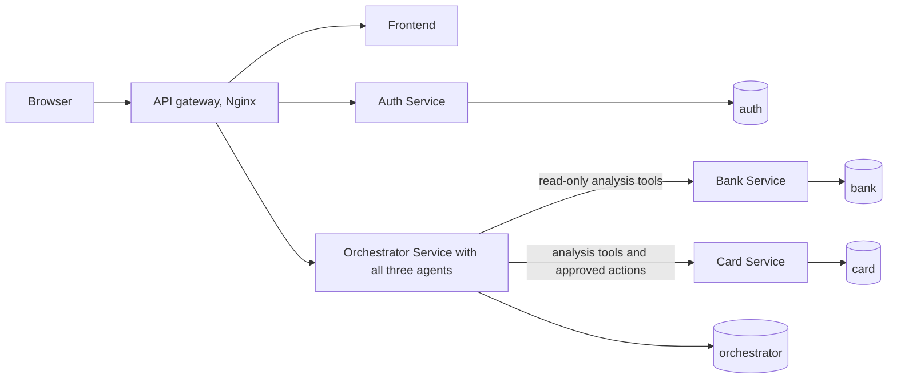

# multiagent-credit-review

Credit Risk Review Agent: a course proof of concept modelled on the credit risk review workflow at Ramp. A risk engine flags a customer whose numbers moved, three agents work out why, and an analyst approves before anything changes.

All customers and data are simulated. This project is not affiliated with Ramp.

## Status

- **Orchestrator**: takes a review signal at `POST /signals`, investigates the case on a LangGraph graph, pauses for the analyst and, where needed, the manager, and sends an approved action to Card. It runs on stand-in specialists and has not been run with a real model yet. See `services/orchestrator/README.md`.
- **Auth, Bank, Card, frontend**: skeletons. Each starts, connects to its own database and answers `/health`.

## Architecture



Four FastAPI services, each with its own Postgres database and login role. The gateway exposes only the frontend, Auth and the Orchestrator. The Bank and Card services are called by the Orchestrator only.

All three agents run in the Orchestrator Service: the main agent and the two specialists (Cash Flow, Credit Behavior), which it calls as tools in-process. Bank and Card run no model. They own the data and serve read-only analysis tools over HTTP.

## Run it

Needs Docker.

```bash
docker compose up --build
```

| URL | What |
|---|---|
| http://localhost:8080 | frontend placeholder |
| http://localhost:8080/api/auth/health | Auth through the gateway |
| http://localhost:8080/api/orchestrator/health | Orchestrator through the gateway |
| http://localhost:8001/health to :8004 | auth, bank, card, orchestrator directly (local only) |

To start again with empty databases: `docker compose down -v`.

### Configuration

Compose falls back to local defaults for the passwords and the signing secret, so no `.env` file is needed on your machine. To override them, or on a server, copy `.env.example` to `.env` and set real values. `.env` is ignored by git.

| Variable | Used by | Notes |
|---|---|---|
| `POSTGRES_PASSWORD` | postgres | superuser password |
| `AUTH_DB_PASSWORD`, `BANK_DB_PASSWORD`, `CARD_DB_PASSWORD`, `ORCHESTRATOR_DB_PASSWORD` | postgres and the matching service | letters, digits and hyphens only, because they go into a connection URL |
| `JWT_SECRET` | the Orchestrator today, every service later | signs and checks tokens. One shared secret in the POC, 32 characters or more |
| `LLM_MODEL`, `LLM_API_KEY` | Orchestrator | the model cases run on, as `provider:model`. Empty by default: signals are stored and their cases wait as `queued` |
| `LANGFUSE_PUBLIC_KEY`, `LANGFUSE_SECRET_KEY`, `LANGFUSE_BASE_URL` | Orchestrator | LangFuse tracing. Empty by default: cases run without tracing. Keys go in your own `.env` only |

Database passwords are applied when the Postgres volume is first created. After changing one, run `docker compose down -v` and start again.

Reserved for later, so every service uses the same name: `AS_OF_DATE`.

## Layout

| Path | What | Owner |
|---|---|---|
| `services/bank` | Bank Service: bank data and read-only analysis tools | Allen |
| `services/card` | Card Service: card data, read-only analysis tools, approved actions | James |
| `services/orchestrator` | Orchestrator Service: the graph, cases and approvals | Vincent |
| `services/orchestrator/app/agents/cash_flow` | Cash Flow Agent | Allen |
| `services/orchestrator/app/agents/credit_behavior` | Credit Behavior Agent | James |
| `services/auth` | login, JWT, roles | to be assigned |
| `gateway` | Nginx API gateway | to be assigned |
| `frontend` | review app (React) | to be assigned |
| `packages/contracts` | models shared by the services | all three |
| `data` | test customers, one source for both data generators | all three |
| `eval` | golden dataset runs and results | to be assigned |
| `infra/postgres` | creates the four databases | to be assigned |

## Working agreements

- One branch per Jira ticket, named after it: `KAN-20-cash-flow-tools`. Open a pull request into `main` and put the ticket key in the title.
- Another member reviews before merge. GitHub does not enforce this on our plan, so it is on us.
- Services never import each other's code and never read each other's database. They talk over HTTP. Shared types live in `packages/contracts`.
- Inside the Orchestrator, each agent folder exposes one entry function. The graph calls that function and nothing else in the folder. An agent reaches data only through the analysis tools, never through a database connection.
- A change to `packages/contracts` or `data` needs all three owners.
- No secrets and no real customer data in git.
- `main` always starts with `docker compose up --build`.

Board: https://lqc0304.atlassian.net/jira/software/projects/KAN/boards/2
