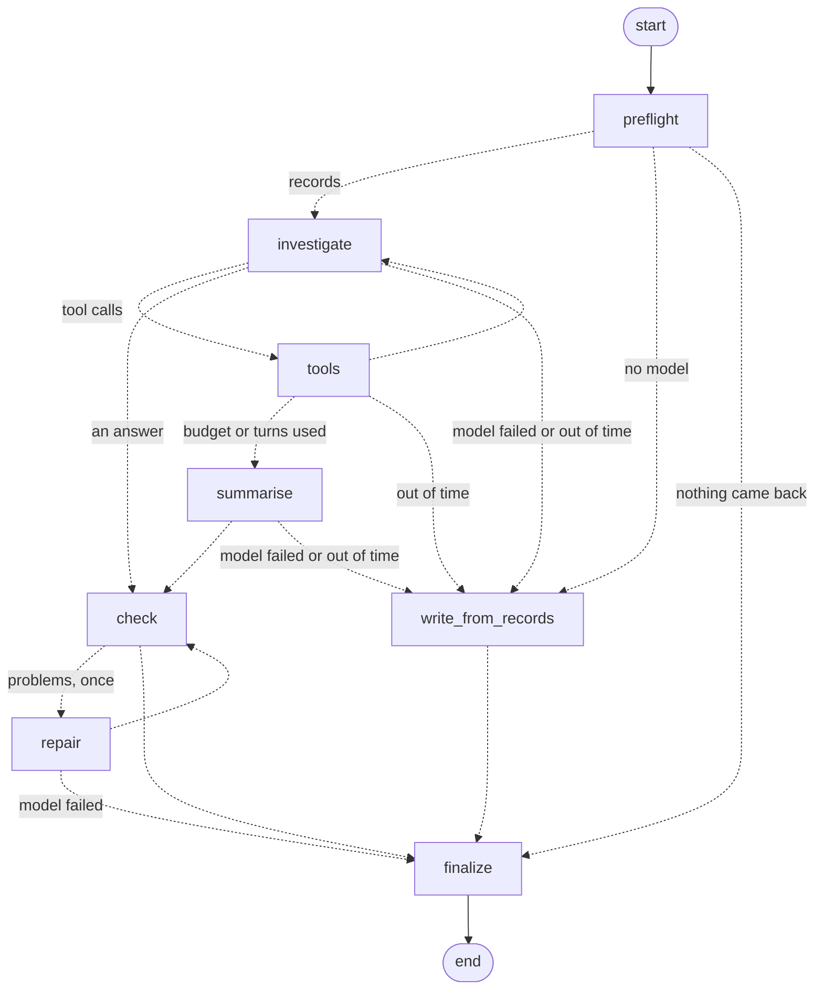

# Card Service agent (Credit Behavior)

Owner: James. KAN-26.

`card_service(request: InvestigateRequest) -> InvestigateResponse`, the same signature as `mock.credit_behavior`, so the graph can swap one for the other (KAN-36). The folder and function are named for the service it reads; its answers still say `agent: "credit_behavior"`, the shared contract's name for this specialist (`contracts.investigate.AgentName`), so the graph and the guidelines take them as the Credit Behavior side. It answers one question about one customer's card: how the card is used and how it is repaid. It keeps nothing between calls and never recommends a limit action. All data and business logic stay on the Card Service; this folder reaches them only through Card's analysis tools (`services/card/README.md`), with a 3-minute service token that names the one customer.

## How a call runs: a LangGraph graph

`agent.py` builds a LangGraph `StateGraph` named `card_service`. Each call runs it once from the start. Every node is a named step of the caller's run, so in LangFuse a case's trace shows `card_service` with these steps inside it, and the model's calls inside `investigate`, `summarise` and `repair`. (Drawn from the compiled graph: `GRAPH.get_graph().draw_mermaid()`.)

| Node | Who | What |
|---|---|---|
| `preflight` | code | calls the tools the topic rests on: `repayments` → last 3 repayments; `paying_account` → the paying account across them; `card_use` → utilization and spend by cycle; no topic → all four. Not counted in the budget |
| `investigate` | model | reads the question and the preflight results, then calls Card tools or answers in JSON |
| `tools` | code | runs the model's tool calls: at most 5 counted, a repeated call gets the earlier result for free, memos marked as data. After 8 model turns (`MAX_TURNS`), or once the budget is used, the next step is `summarise`, so a model that repeats a call cannot loop |
| `summarise` | model | only when the budget or the turns are used up: answers from what was fetched, with no tools |
| `check` | code | the claim is not empty; every cited id was returned by a tool; every figure in a claim is shown by the cited records, read as the case graph reads it (`app.graph.figures`: "$92K", "USD 77,000", "61 percent", numbers above twelve; a multiple such as "3x" is never backed; dates are not checked); no limit or card action is recommended, also in noun, gerund or passive form ("a limit reduction is warranted", "the card ought to be frozen"; after "suggests", a rise or fall is an action only on the limit, the card or the account itself: "suggests lowering the card limit" is refused, "suggests increasing card usage" is a reading; `tests/_action_phrasings.py` holds what both specialists' filters must agree on); while any record says `too_short_to_tell`, a claim may not call things normal or "out of the ordinary" unless it says the history is too short or cites a record that made its own comparison |
| `repair` | model | once, when the check found problems: told what failed, it writes the answer again. Findings the first check accepted are kept unless the new answer cites their records. What still fails is left out and said so in `could_not_determine` |
| `write_from_records` | code | with no model (`LLM_MODEL` unset and none passed in), or when the model gave no answer (the call failed, or time ran out): findings written from the records fetched, saying so |
| `finalize` | code | always adds a finding written by code (`findings.py`) for every failed or late repayment and paying-account change of the kinds the topic answers with (`TOPIC_KINDS`; a record fetched in support of another topic is returned but not written about), even when a model finding cites the record (it may say something else about it); the evidence is every record preflight fetched plus the cited ones, exactly as Card returned them |

The state holds only data: the request, the records by id, the message history, the drafts and the reasons for `could_not_determine`. The model and the Card client travel in the run's context (`AgentContext`), which is never saved. The graph is compiled with `checkpointer=False`, so inside the case graph it does not inherit the case's Postgres checkpointer and saves nothing (`tests/test_card_service_graph.py` checks both this and the step names). The 60-second limit is a deadline in the state, checked before every Card call (in `preflight` and `tools`) and every model call; a Card call times out at min(10 s, the time left). Each Card call runs through its LangChain tool object, so LangFuse and other callbacks see a tool run. The model's `could_not_determine` items are screened for actions too.

`card_service()` never raises: if the graph fails, the answer is written by code from the records Card returned so far, and `could_not_determine` says so. Code-written findings format figures with `app.graph.facts.usd` and `pct` (whole percent), so the graph's own figure check accepts them.

Memos are wrapped in `<memo>...</memo>`, brackets escaped, before the model reads them. If Card does not answer, the findings are empty and `could_not_determine` says which tool failed.

Settings: `CARD_URL` (compose sets `http://card:8000`), `JWT_SECRET`, and the service's one model (`LLM_MODEL`, read in `app/runtime.py`).

## Files

| File | What |
|---|---|
| `agent.py` | the graph: its state, the eight nodes, and the entry function `card_service()` |
| `tools.py` | the Card tools as LangChain tools and plain calls; errors become `{error, message}` |
| `guardrails.py` | memo marking, the evidence pool, the draft checks |
| `findings.py` | findings code writes from records, used for hard facts and when there is no model |
| `prompts.py` | the system prompt and the first and repair messages |

Tests: `services/orchestrator/tests/test_card_service_agent.py` (what an answer holds), `test_card_service_fixes.py` (one regression test per review fix) and `test_card_service_graph.py` (the steps each kind of run takes, and the graph inside a checkpointed caller), against Card responses recorded from the seeded stack (`tests/fixtures/card_tools.json`) and a scripted model. To record them again after a Card change, run the stack and call each tool in that file's keys with a token from `docker compose exec card python -m app.dev_token --sub fixture --customers <id>`.

The swap in `app/runtime.py` is done (KAN-36): the graph asks this agent unless `SPECIALISTS=stand_in`. Its runs on a real model are written up in `eval/card_service/judge/README.md`.
