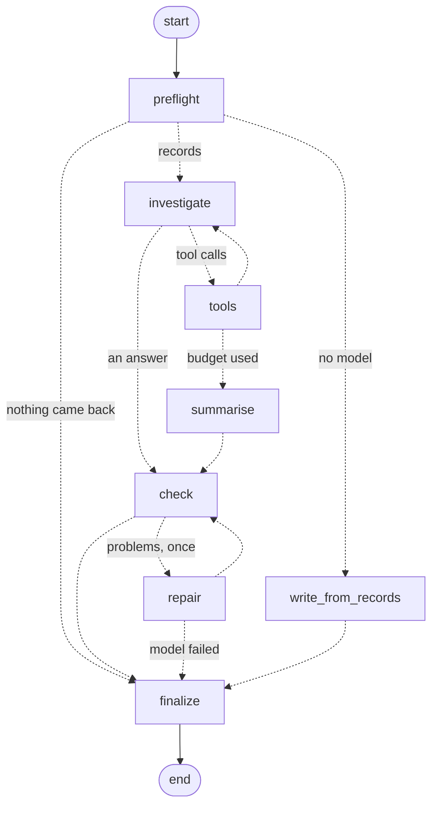

# Card Service agent (Credit Behavior)

Owner: James. KAN-26.

`card_service(request: InvestigateRequest) -> InvestigateResponse`, the same signature as `mock.credit_behavior`, so the graph can swap one for the other (KAN-36). The folder and function are named for the service it reads; its answers still say `agent: "credit_behavior"`, the shared contract's name for this specialist (`contracts.investigate.AgentName`), so the graph and the guidelines take them as the Credit Behavior side. It answers one question about one customer's card: how the card is used and how it is repaid. It keeps nothing between calls and never recommends a limit action. All data and business logic stay on the Card Service; this folder reaches them only through Card's analysis tools (`services/card/README.md`), with a 3-minute service token that names the one customer.

## How a call runs: a LangGraph graph

`agent.py` builds a LangGraph `StateGraph` named `card_service`. Each call runs it once from the start. Every node is a named step of the caller's run, so in LangFuse a case's trace shows `card_service` with these steps inside it, and the model's calls inside `investigate`, `summarise` and `repair`. (Drawn from the compiled graph: `GRAPH.get_graph().draw_mermaid()`.)

| Node | Who | What |
|---|---|---|
| `preflight` | code | calls the tools the topic rests on: `repayments` → last 3 repayments; `paying_account` → the paying account across them; `card_use` → utilization and spend by cycle; no topic → all four. Not counted in the budget |
| `investigate` | model | reads the question and the preflight results, then calls Card tools or answers in JSON |
| `tools` | code | runs the model's tool calls: at most 5 counted, a repeated call gets the earlier result for free, memos marked as data |
| `summarise` | model | only when the budget is used up: answers from what was fetched, with no tools |
| `check` | code | every cited id was returned by a tool; every $ and % in a claim is in the cited records; no limit action is recommended; a `too_short_to_tell` record is never called normal |
| `repair` | model | once, when the check found problems: told what failed, it writes the answer again. What still fails is left out and said so in `could_not_determine` |
| `write_from_records` | code | only with no model (`LLM_MODEL` unset and none passed in): findings written from the preflight records, saying so |
| `finalize` | code | adds a finding written by code (`findings.py`) for any failed or late repayment or paying-account change no accepted finding cites; the evidence is the cited records exactly as Card returned them |

The state holds only data: the request, the records by id, the message history, the drafts and the reasons for `could_not_determine`. The model and the Card client travel in the run's context (`AgentContext`), which is never saved. The graph is compiled with `checkpointer=False`, so inside the case graph it does not inherit the case's Postgres checkpointer and saves nothing (`tests/test_card_service_graph.py` checks both this and the step names). The 60-second limit is a deadline in the state, checked before each model step.

Memos are wrapped in `<memo>...</memo>`, brackets escaped, before the model reads them. If Card does not answer, the findings are empty and `could_not_determine` says which tool failed.

Settings: `CARD_URL` (compose sets `http://card:8000`), `JWT_SECRET`, and the service's one model (`LLM_MODEL`, read in `app/runtime.py`).

## Files

| File | What |
|---|---|
| `agent.py` | the graph: its state, the eight nodes, and the entry function `card_service()` |
| `tools.py` | the Card tools as LangChain tools and plain calls; errors become `{error, message}` |
| `guardrails.py` | memo marking, the evidence pool, the draft checks |
| `findings.py` | findings code writes from records, used for hard facts and when there is no model |
| `prompts.py` | the system prompt and the first and repair messages |

Tests: `services/orchestrator/tests/test_card_service_agent.py` (what an answer holds) and `test_card_service_graph.py` (the steps each kind of run takes, and the graph inside a checkpointed caller), against Card responses recorded from the seeded stack (`tests/fixtures/card_tools.json`) and a scripted model. To record them again after a Card change, run the stack and call each tool in that file's keys with a token from `docker compose exec card python -m app.dev_token --sub fixture --customers <id>`.

Not done yet: the swap in `app/runtime.py` (KAN-36), and a run on a real model.
