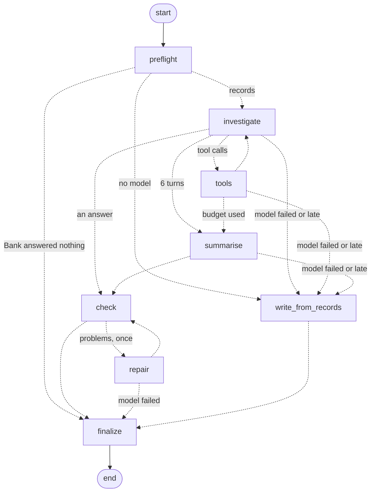

# Cash Flow agent

`cash_flow(request: InvestigateRequest, *, model=None, http=None) -> InvestigateResponse`, the same signature as `mock.cash_flow`, so the graph can swap one for the other (KAN-36). Its answers say `agent: "cash_flow"`. It answers one question about one customer's bank records, keeps nothing between calls, never recommends a limit action and never raises. All data and business logic stay on the Bank Service; this folder reaches them only through Bank's analysis tools, with a 3-minute service token that names the one customer.

## How a call runs: a LangGraph graph

`agent.py` builds a LangGraph `StateGraph` named `cash_flow`. Each call runs it once from the start. Every node is a named step of the caller's run, so in LangFuse a case's trace shows `cash_flow` with these steps inside it, the model's calls inside `investigate`, `summarise` and `repair`, and every Bank call as a tool run.

| Node | Who | What |
|---|---|---|
| `preflight` | code | calls the tools the topic rests on (`tools.PREFLIGHT`, below). Not counted in the budget |
| `investigate` | model | reads the question and the preflight results, then calls Bank tools or answers in JSON. 6 turns at most |
| `tools` | code | runs the model's tool calls: 5 counted at most, a repeat served from the cache without asking Bank again, every call answered |
| `summarise` | model | when the budget or the turns are used up: answers from what was fetched, with no tools |
| `check` | code | every cited id was returned by a tool in this run; every figure in a claim is one the cited records show (`app.graph.figures`, the rule the report check uses: "USD 77,000" and "61 percent" count); no limit or card action is recommended; no customer text is repeated |
| `repair` | model | once, when the check found problems: told what failed, it writes the answer again. What still fails is left out and said so in `could_not_determine` |
| `write_from_records` | code | with no model, or when the model failed or ran out of time: findings written from the records (`findings.py`) |
| `finalize` | code | puts the hard facts of the kinds the topic answers with first (`tools.TOPIC_KINDS`, and for `payee_history` the payment asked about when it is a `vendor_new` or `transfer_own_account` payment, for which Bank returns no history record; a record fetched in support of another topic is returned but not written about); adds to `could_not_determine` what Bank said it could not work out for the preflight calls (each line of its `data.not_available`, `tools.gaps`), and says Bank returned only other topics' records only when Bank gave no reason; checks what the model left in `could_not_determine` and `suggested_next` (no action, no unbacked $ or %, no customer text); the evidence is every record preflight fetched plus every cited one, exactly as Bank returned them, each id once |

Hard facts, written by code whatever the model says, each citing its record: a linked account with `is_stale` true; a `balance_reconciliation` with `reconciled` false; a `weekly_inflow_series` whose `income_trend` is `stopped` or `shrinking`; a `bank_transaction` to the customer's own account at another bank (`transfer_own_account`) or to a new payee (`vendor_new`), with its `share_of_fall`. Whether a share is large is the guidelines' call: no specialist reads `app.policy` (`tests/test_policy.py`).

Time: 60 seconds per call, a deadline checked by every node. A model call is cut off at the deadline (it runs in a thread that carries the node's context), and a Bank call waits at most `min(10 s, what is left)`. If the graph itself fails (a bug, the recursion limit), the entry function answers from every record fetched so far, written by code.

What the model reads: every `*_cents` value as dollars and every `*_bp` as percent (`app.graph.facts.usd`/`.pct`, as the case graph shows records), so it copies figures and never works them out. A `memo`, `note` or `*_text` value is wrapped in `<memo>...</memo>`; any other text with a space, `$`, `%` or angle bracket in `<text>...</text>`; brackets escaped. The evidence that goes out keeps Bank's text as it was.

## Topic to Bank calls

`tools.PREFLIGHT` is the one table that maps a topic to Bank calls; `tools.SPECS` maps a tool name to its path and arguments, exactly as `services/bank/README.md` ("Tool interface for the Cash Flow agent") defines them. Every call is `GET {BANK_URL}/customers/{customer_id}/tools/<path>?<params>` with the `{data, evidence}` envelope.

| Topic | Calls (params from the request) | Records it brings |
|---|---|---|
| `transactions` | `cash_summary?start&end`, `transactions?start&end` | `daily_balance`, `payment_summary`, `bank_transaction` |
| `income` | `income_trend` (no parameters: the 13 weeks to Bank's as-of date) | `weekly_inflow_series` |
| `payee_history` | `payee_history?record_id` (only with a `txn_` record id) | `payee_history`, the payment |
| `accounts` | `account_reporting`, with `?account_id` when the request names one | `linked_account` (and, for an id that is not linked, the review window's `bank_transaction`s to it) |
| `reconciliation` | `balance_vs_txn?start&end` | `balance_reconciliation`, `daily_balance` |
| `prior_year` | `prior_year_compare` (no parameters: the review window) | `prior_year_comparison` |
| none | all of the above but `payee_history` | all of the above |

Settings: `BANK_URL` (compose sets `http://bank:8000`), `JWT_SECRET`, and the service's one model (`LLM_MODEL`, read in `app/runtime.py`).

## Files

| File | What |
|---|---|
| `agent.py` | the graph: its state, the nodes, and the entry function `cash_flow()` |
| `tools.py` | the Bank tools as LangChain tools, the topic table, Bank errors as `{error, message}` |
| `guardrails.py` | what the model reads, the draft checks |
| `findings.py` | findings code writes from records: hard facts, and the answer with no model |
| `prompts.py` | the system prompt, the first, summary and repair messages |

Tests: `test_cash_flow_agent.py`, `test_cash_flow_regressions.py`, `test_cash_flow_graph.py`, `test_cash_flow_fixture.py` (the agent with no model returns every record the stand-in returns, unchanged, and passes its own checks), `test_cash_flow_case.py` (inside the real case graph, the same guideline outcomes as `mock.cash_flow` for c_002, c_003, c_005, c_009, c_011, c_012). Bank answers from `tests/fixtures/bank_tools_standin.json`: the stand-in's records shaped as Bank tool responses (`python -m tests._bank_standin` regenerates it; `tests/_bank_standin.py` says which tool returns which kind). When the Bank branch lands, record its real responses into the same keys.

Not done yet: the swap in `app/runtime.py` (KAN-36), and a run on a real model.
